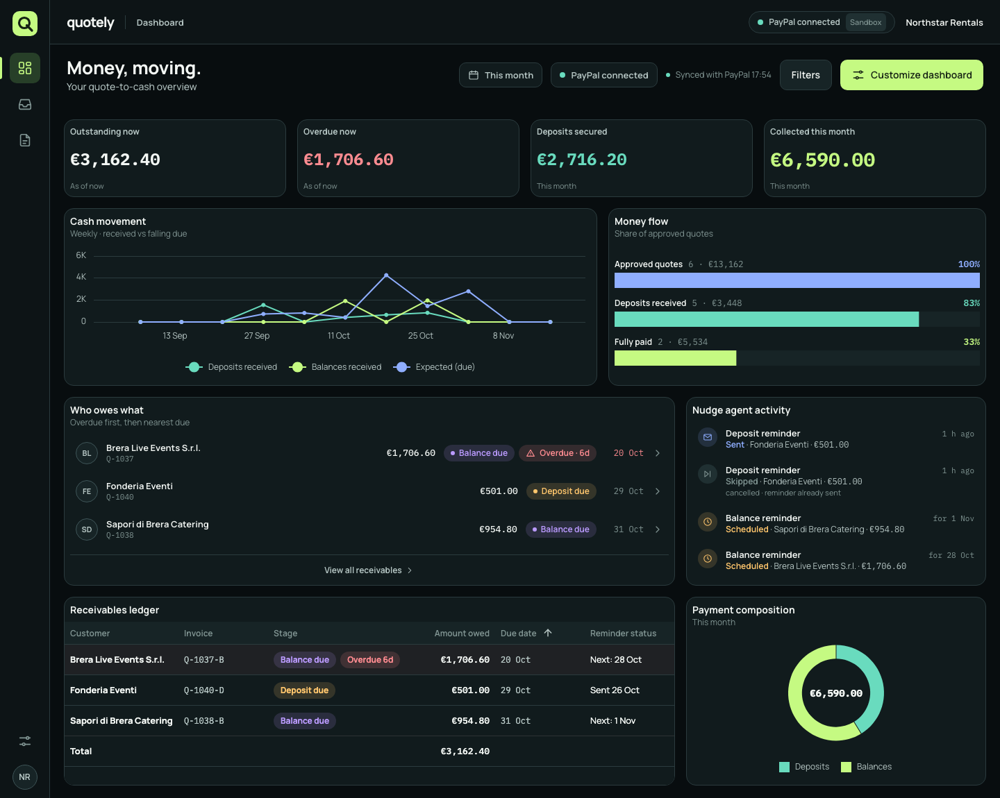
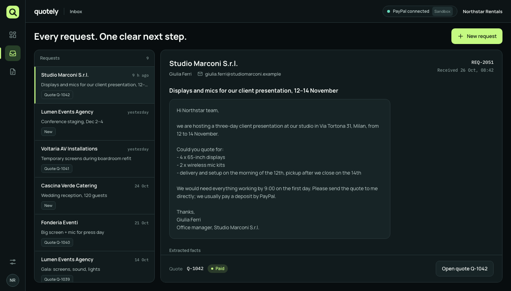
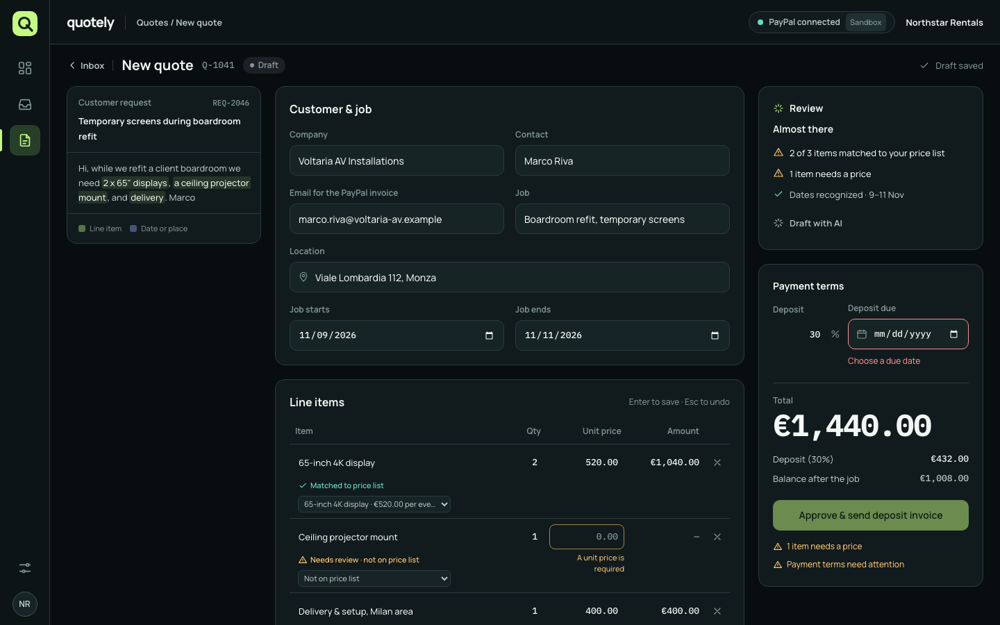
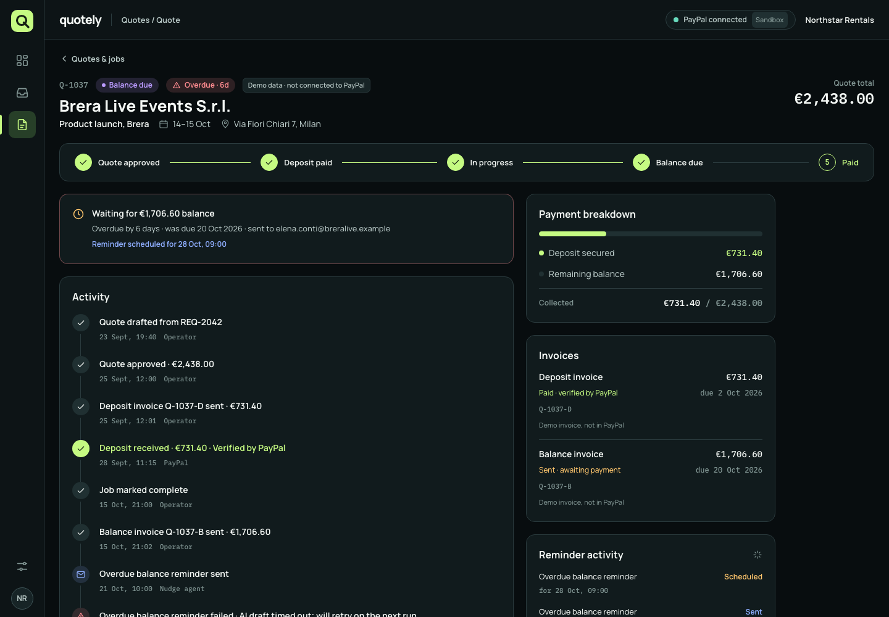
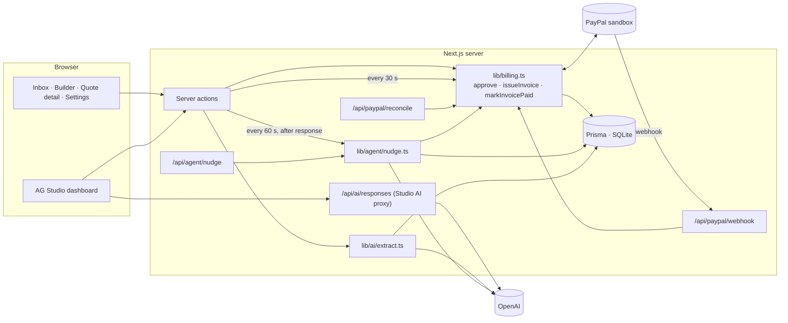

# quotely

**From request to cash, on autopilot.**

Quotely is an AI quote-to-cash app for small B2B service businesses: equipment rental, catering, event agencies, AV installers. A customer email becomes a priced quote, the quote becomes a PayPal deposit invoice, the finished job becomes a balance invoice, and a reminder agent chases what is late, until the money is in.

Built for the [PayPal AI Hackathon](https://paypalaihackathon.devpost.com) on the [PayPal × AG Grid boilerplate](https://github.com/paypaldev/hackathon-paypal-ag-grid-boilerplate).



## What it does

1. **A request arrives.** Paste a customer email into the inbox.
2. **AI drafts the quote.** OpenAI reads the request, extracts the customer, job dates, place and line items, and matches each item to the company price list. It never invents a price: anything not on the price list is flagged *Needs a price* and blocks approval.
3. **The operator reviews.** Every line is editable inline; the source email sits next to the quote with each extracted phrase highlighted and linked to its line.
4. **Approve → deposit invoice.** Quotely creates and sends a PayPal invoice for the deposit (30% by default) through the PayPal Invoicing API.
5. **Payment is detected.** A PayPal webhook (signature-verified) and a 30-second reconciliation both confirm payments with PayPal before anything changes. The quote moves to *Deposit paid* and a "Payment received" toast appears.
6. **Job done → balance invoice.** One click sends the remaining balance as a second PayPal invoice. One invoice per stage, never duplicates.
7. **The nudge agent chases.** It drafts friendly reminders with AI for deposits about to fall due and balances past due, schedules them for 09:00 Milan time, and stops as soon as PayPal confirms payment.
8. **The dashboard shows money in motion.** An AG Studio canvas with KPIs, weekly cash movement, a money-flow funnel, a "who owes what" scoreboard, the agent's activity and a receivables ledger, all editable in Studio's Edit mode.

| Inbox | Quote builder | Quote detail |
|---|---|---|
|  |  |  |

## Tools used

| Tool | How Quotely uses it |
|---|---|
| **PayPal Invoicing API v2** (sandbox) | Create draft invoices, send them, read their status, search by invoice number (to recover safely after a failure), cancel. `lib/paypal.ts` |
| **PayPal Webhooks** | `INVOICING.INVOICE.PAID` and `INVOICING.INVOICE.CANCELLED` at `POST /api/paypal/webhook`, verified with `POST /v1/notifications/verify-webhook-signature`, then re-confirmed by reading the invoice. |
| **PayPal OAuth 2.0** | Client-credentials token, cached until just before expiry. The *Verify connection* button in Settings mints one. |
| **AG Studio** (`ag-studio`, `ag-studio-react` 3.0) | The dashboard: `AgStudioProvider`, a saved report as initial state, native KPI / line / grid / donut widgets, three custom React widgets registered with `createWidgets`, the dark theme via `studioTheme.withParams`, real Edit mode and the AI Assistant. |
| **OpenAI Responses API** | Quote extraction with strict structured JSON output, and reminder drafting. One model, `gpt-5.6-luna`, set in `lib/ai/index.ts`; prompts in `lib/ai/prompts.ts`. The key never reaches the browser. |
| **Next.js 16** (App Router) | Server components, server actions, route handlers, `after()` for the agent run, route-level loading and error states. |
| **Prisma + SQLite** | `prisma/dev.db` locally; the schema is portable to PostgreSQL (integer cents, no native types). |
| **Tailwind CSS 4** | The "Obsidian × Lime" dark theme from `docs/design-system.md`, as CSS tokens. |

## Architecture



**Money rules worth knowing**

- Money is stored as integer cents, EUR only.
- Prices come only from the price list or the operator. The model never sees or returns prices; its SKUs are checked against the price list and its quoted phrases must appear verbatim in the email.
- One invoice per stage: the invoice row is reserved before PayPal is called (unique on quote + stage), so double clicks and retries find it instead of creating another. A retry first searches PayPal by Quotely's unique invoice number (e.g. `Q-1042-D-QXT9`).
- *Paid* means PayPal says `PAID`, in EUR, for the full amount, on a fresh read of the invoice. Webhook and polling both end in the same idempotent `markInvoicePaid()`. A webhook body alone never marks anything paid.
- Every state change is written to an activity log with its actor: operator, PayPal, agent or system.
- Reminders are drafted and logged, never emailed (v1). PayPal itself sends the sandbox invoice emails.

**Quote states**: `draft → approved → deposit_due → deposit_paid (= in_progress) → balance_due → paid`. *Overdue* is a flag computed from due dates, not a state.

```
app/(app)/            Inbox, quote builder, quote detail, quotes list, settings, dashboard
app/(app)/dashboard/  AG Studio: data sources, report state, theme, custom widgets
app/api/paypal/       Webhook and reconciliation endpoints
app/api/agent/nudge/  Nudge agent endpoint
app/debug/            The boilerplate's original pages (raw PayPal endpoints, demo dashboard)
lib/paypal.ts         Every PayPal call (sandbox host fixed)
lib/billing.ts        Approval, invoices, payments, reconciliation
lib/agent/            The nudge agent and reminder text
lib/ai/               Model config, prompts, structured-output calls, extraction
lib/drafting.ts       Requests and draft quotes
lib/cashflow.ts       The dashboard's data
prisma/               Schema and seed (Northstar Rentals, Milan)
docs/                 Design system and PayPal sandbox testing guide
```

## Setup

Requires Node.js 20.9+ and a PayPal sandbox REST app ([developer.paypal.com](https://developer.paypal.com/dashboard/applications/sandbox)).

```bash
npm install                  # also generates the Prisma client
cp env.example .env.local    # then fill in the values below
npm run db:reset             # create prisma/dev.db and load the demo data
npm run dev
```

Open http://localhost:3000 (it lands on the dashboard). `.env.local` is git-ignored.

### Environment variables

| Variable | Required | What it is |
|---|---|---|
| `PAYPAL_CLIENT_ID`, `PAYPAL_SECRET` | yes | Sandbox REST app credentials. |
| `PAYPAL_WEBHOOK_ID` | for webhooks | The webhook's ID from the PayPal dashboard. Without it, webhook events are accepted unverified in development only; payments are still detected by polling. |
| `QUOTELY_CRON_SECRET` | in production | Shared secret for `x-quotely-cron` on `/api/paypal/reconcile` and `/api/agent/nudge`. Open in development when unset. |
| `AG_STUDIO_OPENAI_API_KEY` (or `OPENAI_API_KEY`) | for AI | OpenAI key for quote drafting, reminders and the Studio assistant. Without it, quotes can be created manually. |
| `OPENAI_MODELS` | no | Models the Studio assistant may offer, comma-separated (first is the default). |
| `AG_STUDIO` | no | AG Studio licence key; without it Studio shows a trial watermark. |
| `DATABASE_URL` | no | Leave blank for `prisma/dev.db`. For PostgreSQL, set it and change `provider` in `prisma/schema.prisma`. |

### Scripts

| Command | Does |
|---|---|
| `npm run dev` / `build` / `start` / `lint` | The usual Next.js scripts. |
| `npm run db:push` | Sync the schema to the database. |
| `npm run db:seed` | Replace all data with the demo data (dates are relative to today). |
| `npm run db:reset` | Recreate the database and seed it. |

The demo company is **Northstar Rentals** (Milan) with customers from an events agency, catering companies and an AV installer: 11 price-list items, 3 new requests (including Studio Marconi: 4 × 65" displays, 2 mic kits, delivery and setup, €2,800.00, deposit €840.00), and 6 quotes across every stage including an overdue balance and a fully paid job. Seeded quotes with invoices are marked *Demo data* and never talk to PayPal; only quotes created in the app do.

## Testing the payment flow

[`docs/paypal-sandbox-testing.md`](docs/paypal-sandbox-testing.md) walks through it step by step: draft the Studio Marconi quote, approve it, pay the deposit invoice as the sandbox buyer, watch it arrive, complete the job and pay the balance. It also covers registering the webhook through ngrok (`https://<your-ngrok-host>/api/paypal/webhook`, events *Invoicing invoice paid* and *Invoicing invoice cancelled*).

The scheduler endpoints can be called from any cron:

```bash
curl -X POST http://localhost:3000/api/paypal/reconcile -H "x-quotely-cron: $QUOTELY_CRON_SECRET"
curl -X POST http://localhost:3000/api/agent/nudge     -H "x-quotely-cron: $QUOTELY_CRON_SECRET"
```

## AG Studio notes

The dashboard follows `docs/design-system.md`. Where AG Studio 3.0.0 has no matching setting, the closest documented option is used:

| Design doc | In Studio 3.0.0 | Used instead |
|---|---|---|
| `chromeBackgroundColor` | Exists but is excluded from Studio's theme API | Shell colour on the panel containers (`studioPanelContainerBackgroundColor`). |
| Grid background | No `gridBackgroundColor` | `gridDataBackgroundColor` and `gridOddRowBackgroundColor`. |
| 16px widget gaps, 18px widget padding | No gap parameter; inner padding fixed | `layout.widgetPadding: 8` (8px around each widget = 16px gaps); about 8px inside. |
| Font weights 600 / 650 | Widget typography is `normal` or `bold` | `bold`. |
| Dashed "expected" line | No per-series line style | Three solid series: deposits received (teal), balances received (lime), expected (blue). |
| Palette order 1–6 | Colours are assigned in palette order | Teal and lime first, so deposits are always teal and balances lime on both the line and the donut. |
| Y-axis tick interval | The format parser drops unknown axis keys | A pre-configured copy of the built-in line chart (`quotely-cash-movement`, from Studio's `_ALL_WIDGET_DEFS`) whose widget `options` set the axes, including `interval.minSpacing`. Line charts created in Edit mode keep Studio's defaults. If that export disappears in a later Studio version, the report falls back to the plain line chart. |
| Overdue rows tinted | No row-style hook in the grid widget | The Stage cell renderer adds a marker; a CSS `:has()` rule tints the row. |
| "Sum" labels | Aggregated fields show "(sum)" | Named measures (expressions), e.g. *Deposits received*. |
| Custom widget data | Studio's `context` is read once | Custom widgets read live data from a small store the page updates. |

Edit mode: *Customize dashboard* switches Studio to Edit mode with the AI Assistant folded away so the canvas fits at 1440px; *Done customizing* keeps the layout in this browser; *Reset layout* restores the built-in one. Widgets move by dropping them on free canvas space. The built-in layout sizes the list widgets to the data they hold.

## Security and limits (v1)

- Single operator, no login. Server actions and routes validate every input, but do not deploy publicly with real credentials without adding authentication.
- PayPal sandbox only; the API host is hard-coded.
- No email is sent by Quotely. Reminders are logged and shown in the app.
- Prices in EUR only, no VAT handling.

## Debug pages

The boilerplate's original pages are kept under [`/debug`](http://localhost:3000/debug): raw PayPal endpoints in AG Grid (`/products`, `/plans`, `/invoices`, `/transactions`, `/balances`) and its demo AG Studio dashboard (`/debug/dashboard`).

## License

[MIT](LICENSE)
